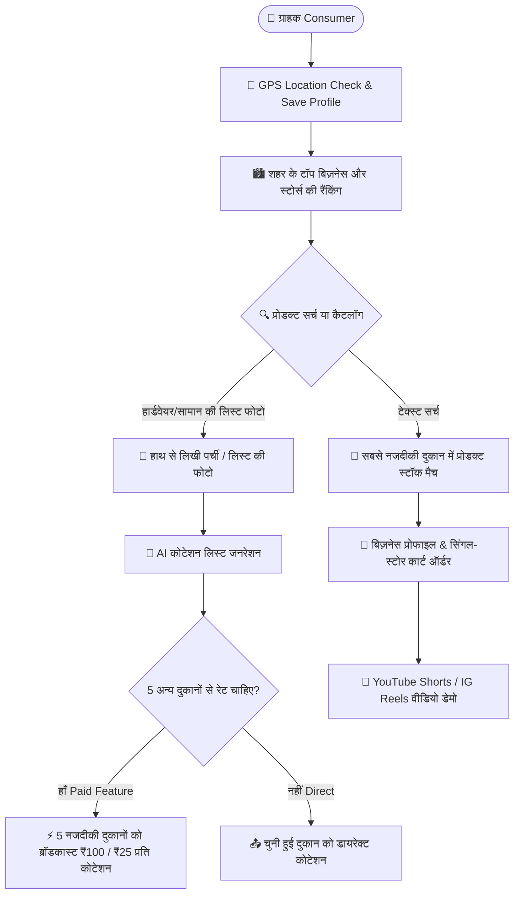

# 🌐 Hyperlocal Marketplace & Consumer Discovery Engine (भविष्य का मुख्य मार्केटप्लेस आर्किटेक्चर एवं एल्गोरिदम)

> **स्थिति (Status):** फ्यूचर फेज रोडमैप (जब कोर अकाउंटिंग व ईआरपी पूरी तरह संपन्न और टेस्टेड हो जाएगी)  
> **उद्देश्य:** इस एकाउंटिंग सॉफ्टवेयर से जुड़े सभी व्यापारियों (Sellers) को एक बड़े कंज्यूमर मार्केटप्लेस में जोड़ना, ताकि स्थानीय ग्राहक (Buyers) अपने शहर के सबसे करीबी स्टोर से खरीदारी कर सकें।

---

## 📌 1. Amazon / Meesho जैसी रियलिस्टिक और आकर्षक प्रोडक्ट इमेजेस का रहस्य

### ❓ PDF इमेजेस बनाम Amazon/Meesho इमेजेस में फर्क क्यों होता है?

| पैमाना | Amazon / Meesho की इमेजेस | PDF से ली गई इमेजेस |
|---|---|---|
| **रिज़ॉल्यूशन और DPI** | 2000x2000 से 3000x3000 पिक्सल (300 DPI), अल्ट्रा हाई-डेफिनिशन | 72 DPI, 300x300 या 500x500 पिक्सल (कंप्रेस्ड ताकि PDF साइज छोटा रहे) |
| **बैकग्राउंड** | 100% शुद्ध सफेद `RGB(255, 255, 255)` बिना किसी दाग या परछाई के | मटमैला, कागज की बनावट, या स्कैनर का ग्रे बैकग्राउंड |
| **ड्रॉप शैडो (Drop Shadow)** | प्रोडक्ट के नीचे नैचुरल सॉफ्ट कॉन्टैक्ट शैडो होती है, जिससे सामान असली लगता है | कोई परछाई नहीं होती, जिससे प्रोडक्ट स्क्रीन पर 'सपाट' और 'नकली स्टीकर' जैसा दिखता है |
| **3D CAD रेंडरिंग** | कई बड़े ब्रांड्स (पेंट की बाल्टी, हार्डवेयर, इलेक्ट्रॉनिक्स) असली कैमरे से नहीं, बल्कि **3D रेंडर (KeyShot/Blender)** से बनते हैं | मोबाइल कैमरे या इनवॉइस पेपर की स्कैन कॉपी |
| **स्टूडियो लाइटिंग** | 3-पॉइंट डिफ्यूज्ड सॉफ्टबॉक्स लाइटिंग से मेटल और प्लास्टिक की चमक उभरती है | ऑफिस की फ्लोरोसेंट लाइट या फ्लैट मोबाइल फ्लैश |

### 💡 हमारे ऐप के लिए समाधान (AI Image Processing Pipeline):
1. **AI Background Remover + Natural Shadow Engine:** जब भी सेलर प्रोडक्ट की फोटो खींचे या अपलोड करे, बैकग्राउंड अपने आप हटकर शुद्ध सफेद हो जाए और नीचे हल्की नेचुरल ड्रॉप-शैडो (परछाई) लग जाए।
2. **AI Super-Resolution (Upscaler):** पुरानी या कम रेज़ोल्यूशन वाली इमेजेस को 4x AI अपस्केल (Real-ESRGAN / Sharpness Filter) करके क्रिस्टल-क्लियर बनाया जाए।

---

## 🧠 2. मुख्य मार्केटप्लेस एल्गोरिदम (Marketplace Discovery & Matching Algorithm)

जब ऐप का कंज़्यूमर/मार्केटप्लेस वर्जन बनेगा, उसके लिए एक अलग मॉड्यूल व एल्गोरिदम फाइल (`algorithms/hyperlocalDiscovery.js` एवं `algorithms/quotationBidding.js`) तैयार की जाएगी।



---

### 📍 मॉड्यूल A: GPS लोकेशन ट्रैकिंग और बायर प्रोफाइल (Buyer Geolocation Engine)
1. **GPS लोकेशन डिटेक्शन:**
   - ऐप खुलते ही यूजर की सटीक GPS लोकेशन (`Latitude`, `Longitude`, `City`, `Pincode`, `Geohash`) फेच की जाएगी।
   - यूजर की प्रोफाइल (`buyer_profiles`) में पसंदीदा डिलीवरी एड्रेस और लोकेशन हिस्ट्री सेव होगी।
2. **PostGIS / Geospatial इंडेक्सिंग:**
   - सभी रजिस्टर्ड सेलर दुकानों की लोकेशन `GEOGRAPHY(Point)` फॉर्मेट में स्टोर होगी।
   - Haversine फॉर्मूले द्वारा 1 से 15 किमी के दायरे में सबसे तेज क्वेरी रिस्पॉन्स।

---

### 🏙️ मॉड्यूल B: शहर के टॉप बिज़नेस की रैंकिंग (City-Wise Top Business Algorithm)
ग्राहक के शहर में टॉप बिज़नेस को प्राथमिकता देने का स्कोरिंग एल्गोरिदम:
$$\text{Rank Score} = (R \times 0.35) + (F \times 0.25) + \left(\frac{1}{D} \times 0.20\right) + (S \times 0.10) + (V \times 0.10)$$
- **$R$ (Rating):** ग्राहकों की औसत रेटिंग (1 से 5 स्टार)।
- **$F$ (Fulfillment Rate):** ऑर्डर समय पर पूरा करने का प्रतिशत।
- **$D$ (Distance):** ग्राहक से दुकान की दूरी (जितनी कम दूरी, उतना अधिक स्कोर)।
- **$S$ (Stock Availability):** दुकान में एक्टिव व लाइव प्रोडक्ट्स की संख्या।
- **$V$ (Video / Reels Presence):** जिन दुकानों ने वीडियो रील्स लगा रखी हैं, उन्हें एक्स्ट्रा बूस्ट।

---

### 🔍 मॉड्यूल C: हाइपरलोकल प्रोडक्ट सर्च व डायरेक्ट स्टोर रूटिंग (Nearest Product & Store Profile)
1. **नजदीकी उपलब्धता (Proximity First):**
   - जब कोई ग्राहक सर्च करेगा (उदा. *"Asian Paints Apex 20L"* या *"1/2 इंच GI Elbow"*), तो एल्गोरिदम सबसे पहले **उसके 3-5 किमी के दायरे में जिस दुकान में स्टॉक > 0 है**, उसे सबसे ऊपर दिखाएगा।
2. **सिंगल बिज़नेस मॉडल रूटिंग (Single Store Profile):**
   - ग्राहक जब प्रोडक्ट पर क्लिक करेगा, तो वह सीधे उस **दुकानदार की मुख्य प्रोफाइल** पर जाएगा।
   - **फायदा:** इससे ग्राहक उसी दुकान से बाकी सामान (ब्रश, थिनर, रोलर आदि) भी एक साथ चुनकर एक ही डिलीवरी/ऑर्डर में मंगा सकता है (मिक्स्ड कार्ट की डिलीवरी समस्या नहीं होगी)।

---

### 📸 मॉड्यूल D: इमेज/पर्ची से कोटेशन और 5 दुकानों का रेट कम्पेरिजन (Quotation Bidding & Monetization Engine)

हार्डवेयर, सेनेटरी, बिल्डिंग मैटेरियल और किराना में ग्राहक अक्सर हाथ से लिखी पर्ची लाते हैं:

1. **इमेज-टू-कोटेशन (Visual List Extraction):**
   - ग्राहक मिस्त्री या खुद की लिखी पर्ची/फोटो अपलोड करेगा।
   - OCR/AI विज़न पर्ची से आइटम्स, साइज और क्वांटिटी की डिजिटल लिस्ट तैयार करेगा।
2. **मल्टी-स्टोर रेट कम्पेरिजन (मोनिटाइजेशन व रेवेन्यू मॉडल):**
   - ग्राहक से पूछा जाएगा:
     > *"क्या आप इसी पर्ची का रेट अपने शहर की 5 अन्य टॉप दुकानों से कम्पेयर करके सबसे सस्ता रेट पाना चाहते हैं?"*
3. **डायनामिक प्राइजिंग नियम (Configurable Algorithm Rules):**
   - **पैकेज रेट:** ₹100 में 5 दुकानों से कोटेशन कम्पेरिजन।
   - **प्रति कोटेशन रेट:** ₹25 प्रति अतिरिक्त कोटेशन।
   - **एल्गोरिदम में फ्लेक्सिबिलिटी:** यह प्राइजिंग डेटाबेस कॉन्फ़िगरेशन (`marketplace_pricing_rules`) से चलेगी ताकि एडमिन इसे त्योहारों या शहरों के अनुसार बदल सके (उदा. ₹50 ऑफर या पहली बार फ्री)।
4. **सेलर बिडिंग डैशबोर्ड:**
   - 5 नजदीकी दुकानदारों के पास 30 मिनट का टाइमर जाएगा। दुकानदार अपने बेस्ट रेट डालेंगे।
   - ग्राहक के पास सबसे कम रेट देने वाली दुकान से ऑर्डर फाइनल करने का विकल्प होगा।

---

### 🎥 मॉड्यूल E: सोशल वीडियो कॉमर्स (YouTube Shorts & Instagram Reels)
- हर दुकानदार अपनी प्रोफाइल और प्रोडक्ट्स के लिए वीडियो लिंक जोड़ सकेगा:
  - **YouTube Shorts URL**
  - **Instagram Reels URL**
- ग्राहक दुकान की प्रोफाइल पर स्क्रॉल करते हुए प्रोडक्ट्स के लाइव वीडियो, अनबॉक्सिंग, या उपयोग के तरीके देख सकेंगे, जिससे विश्वास और बिक्री 300% बढ़ती है।

---

## 🗂️ एल्गोरिदम फाइल स्ट्रक्चर (भविष्य में बनने वाले फोल्डर्स):
```text
apps/backend/src/algorithms/
  ├── buyerGeoMatching.js       # GPS दूरी व नजदीकी स्टोर कैलकुलेशन
  ├── cityBusinessRanking.js    # शहर के टॉप दुकानों की स्कोरिंग
  ├── visualQuotationEngine.js  # फोटो से पर्ची और कोटेशन बनाना
  ├── quotationBiddingEngine.js # 5 दुकानों का रेट मुकाबला व फीस नियम
  └── reelsFeedEngine.js        # YouTube/Instagram वीडियो रील्स फेचर
```
